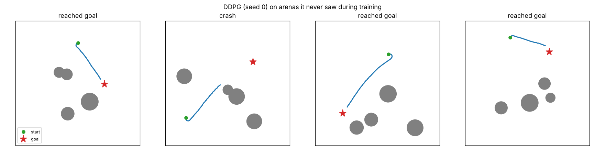

# TurtleBot3 navigation with reinforcement learning: DQN vs DDPG


Can a TurtleBot3 learn to drive to a goal and avoid obstacles using nothing but its lidar and the direction to the goal? This repo trains two agents on that task and compares them:

- **Double DQN**: picks one of 5 turning rates
- **DDPG**: outputs a continuous turning rate

Both agents, the neural network (backprop and Adam included) and a small 2D simulator are written in plain NumPy. I wanted to see every gradient, not hide it behind a framework.



## Where this comes from

In the Mobile Robots course at the University of Klagenfurt our team (with Moritz) worked on state estimation, RL control and YCB object classification for a TurtleBot3 in ROS/Gazebo. Our RL part never got past setting up the networks; the reward curves in our submission were placeholders. That bothered me, so I rebuilt the control part properly in November 2026: a real training loop, held-out evaluation and tests.

I used an AI coding assistant (Claude) while building this, mainly for drafting code and reviewing it. The task design, the reward, the evaluation choices and what goes into the README are mine, and I check every number by running it.

## Results

Simulator only (not Gazebo yet). 800 training episodes per run, 3 seeds per agent. Evaluation uses the greedy policy on **arenas the agent never saw during training**, 200 episodes per seed. Numbers are means over seeds; per-seed values are in [`results/evaluation.json`](results/evaluation.json).

| Policy | Goal reached | Crashes | Time without crashing* | Goals per run* |
| --- | --- | --- | --- | --- |
| DDPG | **81%** | 19% | **52.8 s** | **3.9** |
| Double DQN | 76% | 24% | 49.4 s | 3.3 |
| Random actions | 3.5% | 96.5% | 12.7 s | 0 |

\*Our course metric. The robot keeps getting new goals until it crashes or 120 s pass (50 runs per seed).

**Noisy lidar** (Gaussian noise the agents never saw in training):

| Lidar noise (std) | 0 | 2 cm | 5 cm |
| --- | --- | --- | --- |
| DDPG goal rate | 81% | 76% | 74% |
| DQN goal rate | 76% | 73% | 65% |


What I take from this:
- Both agents clearly learn; random driving almost never reaches a goal.
- DDPG learns faster in the first 100 episodes and degrades less with noise. Its lead in final success is small, though, and inside the seed-to-seed spread.
- About one run in five still ends in a crash, usually a late turn next to an obstacle (second panel above). This is a baseline, not a controller I'd put on a real robot yet.

## Setup

- **Observation:** 24 lidar ranges (downsampled from the LDS-01's 360, max 3.5 m) + distance and angle to the goal
- **Action:** turning rate; forward speed fixed at 0.15 m/s (Burger limit 0.22 m/s)
- **Reward:** +10 per metre closer to the goal, +100 for reaching it, −100 for a collision, −0.01 per step
- **Arena:** 4 × 4 m with 4 random round obstacles, new layout every episode

## Files

| | |
| --- | --- |
| `tb3rl/sim.py` | 2D simulator: differential drive, ray-cast lidar, collisions |
| `tb3rl/nn.py` | MLP with manual backprop, Adam, gradient clipping |
| `tb3rl/agents.py` | Double DQN and DDPG, replay buffer, target networks |
| `tb3rl/train.py` | training loop, CSV logs per episode |
| `tb3rl/evaluate.py` | held-out evaluation, time without crashing, noise check, plots |
| `tb3rl/plot_trajectory.py` | draws episodes like the figure above |
| `tb3rl/ros_env.py` | ROS Noetic + Gazebo wrapper with the same interface |
| `tests/` | gradient checks against finite differences, simulator and agent tests |

## Run it

```bash
pip install -r requirements.txt
python -m unittest discover -s tests -v

for a in dqn ddpg; do for s in 0 1 2; do python -m tb3rl.train --algo $a --episodes 800 --seed $s; done; done
python -m tb3rl.evaluate
python -m tb3rl.plot_trajectory --algo ddpg
```

All six training runs take a few minutes on a laptop CPU. Runs are seeded, so you should get the same numbers.

## Gazebo

`tb3rl/ros_env.py` talks to Gazebo through `/scan`, `/odom` and `/cmd_vel` and resets with `/gazebo/reset_world`:

```bash
export TURTLEBOT3_MODEL=burger
roslaunch turtlebot3_gazebo turtlebot3_stage_2.launch
```

I haven't run it in Gazebo for this version yet, so there are no Gazebo numbers here. That is the next thing I want to do.

## Limitations

- Kinematic simulator: no wheel slip, inertia or sensor delay.
- Only the turning rate is learned; speed is fixed.
- Static obstacles only.

## Next

1. Run and report the Gazebo experiment (sim-to-sim transfer).
2. Let the agents control speed as well.
3. Moving obstacles, and a comparison with TD3 and SAC.
