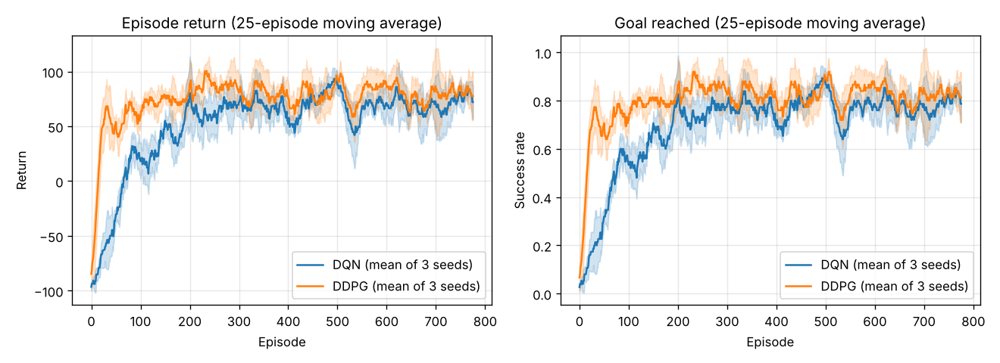

# TurtleBot3 Navigation with Deep Reinforcement Learning (DQN vs DDPG)

A TurtleBot3 learns to reach goals and avoid obstacles using only its lidar and the direction to the goal. Two agents are compared on the same task: **Double DQN** (5 discrete turning rates) and **DDPG** (continuous turning rate). Both are written from scratch in NumPy, including backpropagation and Adam, so every step of learning is visible.

## Background

This is a rebuild of the robot-control part of my **Mobile Robots** course project at the University of Klagenfurt (state estimation, RL control and YCB object classification, done as a team with Moritz). The original course code only set up the networks and used placeholder rewards. I rebuilt the control part properly as a complete, tested, reproducible project, starting in November 2026.

## Results (2D simulator, 3 seeds per agent)

Training: 800 episodes per seed. Evaluation: greedy policy on **arenas never seen during training** (200 episodes per seed). Values are the mean over seeds; per-seed values are in `results/evaluation.json`.

| Policy | Goal reached | Crash rate | Time without crashing* | Goals per run* |
| --- | --- | --- | --- | --- |
| DDPG | **81%** | 19% | **52.8 s** | **3.9** |
| Double DQN | 76% | 24% | 49.4 s | 3.3 |
| Random actions (baseline) | 3.5% | 96.5% | 12.7 s | 0.0 |

\*"Time without crashing" (the course metric): the robot keeps driving to new random goals until it crashes or 120 s pass; 50 runs per seed.



Honest reading: both agents learn to navigate far better than chance; DDPG is slightly ahead here, but the gap is within seed-to-seed variation (see the shaded bands). Crashes are still frequent, so this is a learning baseline, not a deployable controller.

## What is in the repo

| File | Purpose |
| --- | --- |
| `tb3rl/sim.py` | 2D TurtleBot3 simulator: differential drive, 24-beam lidar (LDS-01 range 3.5 m), circular obstacles, Burger velocity limits |
| `tb3rl/nn.py` | MLP with manual backpropagation, Adam and gradient clipping |
| `tb3rl/agents.py` | Double DQN (soft target updates, epsilon-greedy) and DDPG (actor-critic, target networks, Gaussian exploration) |
| `tb3rl/train.py` | Training loop, per-episode CSV logs and saved policies |
| `tb3rl/evaluate.py` | Held-out evaluation, time-without-crash metric, random baseline, learning-curve plot |
| `tb3rl/ros_env.py` | ROS Noetic + Gazebo wrapper with the same interface (`/scan`, `/odom`, `/cmd_vel`) |
| `tests/` | Finite-difference gradient checks, simulator collision/goal/reward tests, agent smoke tests |

**Observation:** 24 lidar ranges (scaled) + distance and angle to the goal. **Reward:** +10 per metre of progress toward the goal, +100 on reaching it, −100 on collision, −0.01 per step.

## Reproduce

Python 3.9+:

```bash
pip install -r requirements.txt
python -m unittest discover -s tests -v
for a in dqn ddpg; do for s in 0 1 2; do python -m tb3rl.train --algo $a --episodes 800 --seed $s; done; done
python -m tb3rl.evaluate --seeds 0 1 2 --episodes 200
```

Training all six runs takes a few minutes on a laptop CPU.

## Running in Gazebo (ROS Noetic)

```bash
export TURTLEBOT3_MODEL=burger
roslaunch turtlebot3_gazebo turtlebot3_stage_2.launch
```

Then use `tb3rl.ros_env.GazeboNavEnv(goals=[(1.0, 0.5), (-1.0, -1.0)])` in place of `NavEnv`. **Status:** the Gazebo wrapper has not yet been run in this repository, so no Gazebo results are reported. All numbers above come from the 2D simulator.

## Limitations

- The 2D simulator is kinematic: no wheel slip, inertia or sensor delay, and lidar noise is off by default.
- Linear speed is fixed at 0.15 m/s; the agents control only the turning rate.
- Policies trained in 2D are expected to need fine-tuning in Gazebo and on a real robot.

## Next steps

Run and report the Gazebo experiment; add lidar noise and dynamic obstacles; let the agents control linear speed too; compare against TD3/SAC.
